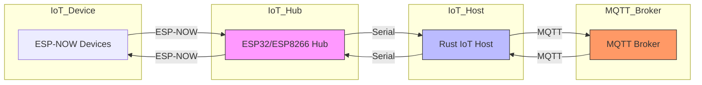

# IoT Host - Serial to MQTT Bridge

A Rust application that bridges serial communication with MQTT for IoT device management.

## Overview

This application connects to an ESP-NOW hub via serial port and forwards device events to MQTT topics. It also subscribes to MQTT command topics and sends commands back to devices through the hub.

### Architecture



## Communication Protocol

### Serial Format

Messages are transmitted as colon-separated strings:

```
mac:event:key1:value1:key2:value2:...
```

**Example:**

```
aa-bb-cc-dd-ee-ff:awake:temp:25.5:humi:60
```

- **MAC Address**: 6 hexadecimal bytes in `xx-xx-xx-xx-xx-xx` format (e.g., `aa-bb-cc-dd-ee-ff`)
- **Event**: `awake`, `cmd`, or `sleep`
- **Key-Value Pairs**: Up to 8 pairs of sensor data

### MQTT Topics

- **Device Events**: `homeassistant/{device_class}/{mac}/{field}/state`
- **Device Commands**: `homeassistant/{device_class}/{mac}/{field}/command`
- **HA Discovery**: `homeassistant/{device_class}/{mac}/{field}/config`

## Installation

### Prerequisites

- Rust 1.70+ (edition 2021)
- Cargo (comes with Rust)
- Docker (optional, for containerized deployment)

### Build from Source

```bash
cd iot__host
cargo build --release
```

### Run

```bash
# Set environment variables
export SERIAL_PORT=/dev/ttyUSB0
export BAUD_RATE=115200
export MQTT_HOST=localhost
export MQTT_PORT=1883

# Run
cargo run --release
```

## Docker Deployment

### Build Image

```bash
docker build -t iot-host .
```

### Run Container

```bash
docker run -it --rm \
  --name iot-host \
  -e SERIAL_PORT=/dev/ttyUSB0 \
  -e BAUD_RATE=115200 \
  -e MQTT_HOST=mqtt-broker \
  -e MQTT_PORT=1883 \
  -v /dev/ttyUSB0:/dev/ttyUSB0 \
  iot-host
```

## Configuration

| Environment Variable | Default                        | Description             |
| -------------------- | ------------------------------ | ----------------------- |
| `SERIAL_PORT`        | `/dev/ttyUSB0`                 | Serial port device path |
| `BAUD_RATE`          | `115200`                       | Serial port baud rate   |
| `MQTT_HOST`          | `localhost`                    | MQTT broker hostname    |
| `MQTT_PORT`          | `1883`                         | MQTT broker port        |
| `API_PORT`           | `8080`                         | HTTP API server port    |
| `DB_PATH`            | `/var/lib/iot_host/devices.db` | SQLite database path    |

### Home Assistant Device Configuration API

The host provides a REST API for device configuration:

#### POST /api/device - Upsert Device

Create or update device configuration with MQTT topic setup.

**Request Body:**

```json
{
  "mac": "AA_BB_CC_DD_EE_00",
  "device_name": "Living Room Sensor",
  "mqtt_configs": [
    {
      // internal service will compose mac, type, field into topic eg. `homeassistant/<type>/<mac>/<field>/config
      "type": "sensor",
      "field": "temperature",
      "payload": {
        "device_class": "temperature",
        "unit_of_measurement": "°C"
      }
    }
  ],
  "serial_to_mqtt": {
    // serial event as key
    "wake": {
      // serial field as key, 1 field can populate more than 1 topic eg. both cmd and state topic
      "temp": [
        {
          "type": "sensor",
          "field": "temperature",
          "topic": "state",
          "device_type": "value" // `value`: directly publish the value to mqtt
        }
      ],
      "light1": [
        {
          "type": "servo",
          "field": "light_1",
          "topic": "command",
          "device_type": "mapping" // `mapping`: use specific func to convert the value and puhlish to mqtt. the func requires type, topic, payload to determine which mapping should be used
        }
      ]
    }
  },
  "mqtt_to_serial": {
    // field as key
    "light_1": {
      "value_type": "servo_command",
      "topic_type": "light", // not in use for servo command
      "topic_field": "light_1", // service use `light_1` to find the correct topic. eg. `light_1_direction/state` -> direction; `light_1_on/state` -> on value; `light_1_off/state` -> off value; `light_1/command` -> action
      "topic": "state" // not in use for servo command
    },
    "sleep_dur": {
      "type": "value",
      // service will compose the topic to read value from
      "topic_type": "light",
      "topic_field": "sleep_duration",
      "topic": "command"
    }
  }
}
```

**Response:**

```json
{
  "success": true,
  "message": "Device config saved for AA_BB_CC_DD_EE_00",
  "device_id": "AA_BB_CC_DD_EE_00"
}
```

#### DELETE /api/device/{mac} - Delete Device

Delete a device by MAC address. The device is soft-deleted by setting a `deleted_at` timestamp.

**Request:**

```
DELETE /api/device/AA_BB_CC_DD_EE_00
```

**Response:**

```json
{
  "success": true,
  "message": "Device AA_BB_CC_DD_EE_00 deleted",
  "device_id": "AA_BB_CC_DD_EE_00"
}
```

### DB schema

We will create mqtt table and device table in sqlite to store all required data.

#### MQTT table

```sql
create table mqtt_topic_values (
  mac varchar(32) not null,
  type varchar(64) not null,
  field varchar(64) not null,
  topic varchar (16) not null,
  value varchar(1024) not null,
  created_at TEXT NOT NULL,
  updated_at TEXT NOT NULL,
  deleted_at TEXT
);
```

#### devices table

```sql
create table iot_device_configs (
  mac varchar(32) not null,
  device_name varchar(128) not null,
  mqtt_configs text,
  serial_to_mqtt text,
  mqtt_to_serial text,
  created_at TEXT NOT NULL,
  updated_at TEXT NOT NULL,
  deleted_at TEXT
)
```

## Development

### Run Tests

```bash
cargo test
```

### Project Structure

```
src/
├── lib.rs        # Module exports
├── main.rs       # Application entry point
├── message.rs    # Message types and MQTT topics
├── converter.rs  # Serial/MQTT message conversion
├── serial.rs     # Serial port handler
├── mqtt.rs       # MQTT handler
├── api.rs        # HTTP API server
├── device_store.rs  # SQLite device configuration storage
├── device_state.rs  # In-memory device state tracking
```

## Related Projects

- [iot__hub](../iot__hub): ESP32/ESP8266 hub firmware
- [iot__helper](../iot__helper): ESP-NOW helper library

## License

MIT
