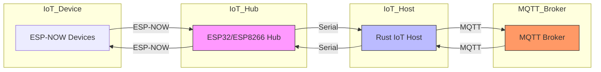

# IoT Host - Serial to MQTT Bridge

A Rust application that bridges serial communication with MQTT for IoT device management.

## Overview

This application connects to an ESP-NOW hub via serial port and forwards device events to MQTT topics. It also subscribes to MQTT command topics and sends commands back to devices through the hub.

### Architecture



## Communication Protocol

### Serial Format

Messages are transmitted as quoted `"<key>:<value>"` pairs (a JSON string
array without the brackets):

```
[AA_BB_CC_DD_EE_00]"temp/ste:25.5","humi/ste:60"
```

- **MAC Address**: 6 hexadecimal bytes in `AA_BB_CC_DD_EE_00` format
- **Key-Value Pairs**: `"<field>/<topic>:<value>"` pairs, comma separated; each
  pair item must be ≤ 20 characters (longer items are skipped with a warning)
- **Setup line** (host → hub on (re)connect): `[<mac>]setup/<encryption_key>/<wake_msg>`,
  followed by one line with all reply_topics-mapped values

### MQTT Topics

- **Device Events**: `homeassistant/{type}/{mac}/{field}/{topic}`
- **Device Commands**: `homeassistant/{type}/{mac}/{field}/command`
- **HA Discovery**: `homeassistant/{type}/{mac}/{field}/config`

## Installation

### Prerequisites

- Rust 1.70+ (edition 2021)
- Cargo (comes with Rust)
- Docker (optional, for containerized deployment)

### Build from Source

```bash
cd iot__host
cargo build --release
```

### Run

```bash
# Set environment variables
export SERIAL_PORT=/dev/ttyUSB0
export BAUD_RATE=115200
export MQTT_HOST=localhost
export MQTT_PORT=1883

# Run
cargo run --release
```

## Docker Deployment

### Build Image

```bash
docker build -t iot-host .
```

### Run Container

```bash
docker run -it --rm \
  --name iot-host \
  -e SERIAL_PORT=/dev/ttyUSB0 \
  -e BAUD_RATE=115200 \
  -e MQTT_HOST=mqtt-broker \
  -e MQTT_PORT=1883 \
  -v /dev/ttyUSB0:/dev/ttyUSB0 \
  iot-host
```

## Configuration

| Environment Variable | Default                        | Description             |
| -------------------- | ------------------------------ | ----------------------- |
| `SERIAL_PORT`        | `/dev/ttyUSB0`                 | Serial port device path |
| `BAUD_RATE`          | `115200`                       | Serial port baud rate   |
| `MQTT_HOST`          | `localhost`                    | MQTT broker hostname    |
| `MQTT_PORT`          | `1883`                         | MQTT broker port        |
| `MQTT_USERNAME`      | _(none; optional)_             | MQTT username           |
| `MQTT_PASSWORD`      | _(none; optional)_             | MQTT password           |
| `API_PORT`           | `8080`                         | HTTP API server port    |
| `DB_PATH`            | `/var/lib/iot_host/devices.db` | SQLite database path    |

### Home Assistant Device Configuration API

The host provides a REST API for device configuration:

#### POST /api/devices - Upsert Device

Create or update device configuration with MQTT topic setup.
It publishes the `mqtt_configs` content to MQTT when the device was first created.

**Request Body:**

```json
{
  "mac": "AA_BB_CC_DD_EE_00",
  "device_name": "Living Room Light",
  "mqtt_configs": [
    {
      "type": "sensor",
      "field": "temperature",
      "config_payload": {
        "device_class": "temperature",
        "unit_of_measurement": "°C"
      },
      "default_state": "abc",
      "default_command": "def"
    }
  ],
  "reply_topics": [
    {
      "type": "sensor",
      "name": "temperature/state",
      "key": "temp/ste"
    }
  ],
  "esp_now_key_mappings": {
    "act/ste": {
      "type": "sensor",
      "name": "temperature/state"
    }
  },
  "wake_msg": "xxx",
  "encryption_key": "key123"
}
```

**Response:**

```json
{
  "success": true,
  "message": "Device config saved for AA_BB_CC_DD_EE_00",
  "device_id": "AA_BB_CC_DD_EE_00"
}
```

#### DELETE /api/devices/{mac} - Delete Device

Delete a device by MAC address. The device is soft-deleted by setting a `deleted_at` timestamp.

**Request:**

```
DELETE /api/devices/AA_BB_CC_DD_EE_00
```

**Response:**

```json
{
  "success": true,
  "message": "Device AA_BB_CC_DD_EE_00 deleted",
  "device_id": "AA_BB_CC_DD_EE_00"
}
```

### DB schema

We will create mqtt table and device table in sqlite to store all required data.

#### MQTT table

```sql
create table mqtt_topic_values (
  mac varchar(32) not null,
  type varchar(64) not null,
  field varchar(64) not null,
  topic varchar (16) not null,
  value varchar(1024) not null,
  created_at TEXT NOT NULL,
  updated_at TEXT NOT NULL
);
```

#### devices table

```sql
create table iot_device_configs (
  mac varchar(32) not null,
  device_name varchar(128) not null,
  mqtt_configs text,
  replay_topics text,
  topic_mappings text,
  wake_msg varchar(128) not null,
  encryption_key varchar(128) not null default '',
  created_at TEXT NOT NULL,
  updated_at TEXT NOT NULL,
  deleted_at TEXT
);
```

## Development

### Run Tests

```bash
cargo test
```

### Project Structure

```
src/
├── lib.rs        # Module exports
├── main.rs       # Application entry point
├── config.rs     # Environment configuration
├── model.rs      # Core types, MQTT topic compose/parse, MAC normalization
├── protocol.rs   # Serial line parse/compose (ESP-Now msg format)
├── db.rs         # SQLite storage (iot_device_configs, mqtt_topic_values)
├── serial.rs     # Serial port reader/writer thread with reconnect
├── mqtt.rs       # MQTT client wrapper (rumqttc)
├── bridge.rs     # Orchestration: serial <-> MQTT, setup messages
└── api.rs        # HTTP API server (axum)
```

## Related Projects

- [iot__hub](../iot__hub): ESP32/ESP8266 hub firmware
- [iot__helper](../iot__helper): ESP-NOW helper library

## License

MIT
